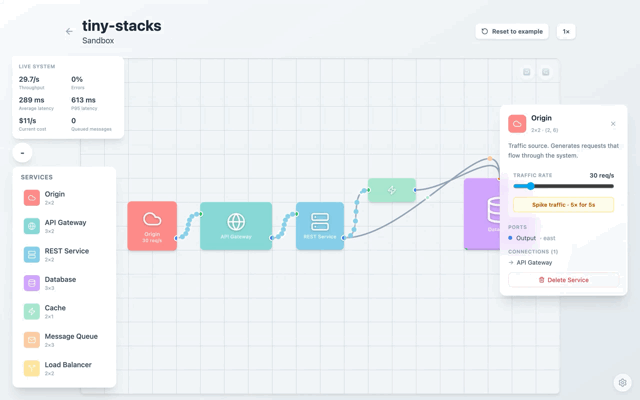

<p align="center">
  
</p>

<h1 align="center">tiny-stacks</h1>

<p align="center">
  A browser game for building microservice architectures and seeing how traffic moves through them.
</p>

<p align="center">
  <a href="https://tiny-stacks.dawichi.dev">Play it live</a> ·
  <a href="#screenshots">Screenshots</a> ·
  <a href="#how-to-play">How to play</a>
</p>

[](https://github.com/dawichi/tiny-stacks/actions/workflows/ci.yml)

---

## What is this?

tiny-stacks turns backend architecture into a visual puzzle. Place REST services, databases, caches, load balancers,
message queues, and gateways on a grid. Connect their ports, then watch animated requests reveal how the system handles
normal traffic, a peak, or a service outage.

The game runs entirely in your browser. It has no backend; boards and progress are saved in local storage.

## Screenshots

<p align="center">
  
</p>

<p align="center">
  <a href="https://tiny-stacks.dawichi.dev/screenshots/tiny-stacks-demo.mp4">Watch the 9-second MP4</a>
</p>

<p align="center">
  
</p>

<p align="center">
  
</p>

## How to play

**Core loop:** Place → Connect → Watch → Optimize

- **Place** services from the palette onto the grid.
- **Connect** an output port to an input port.
- **Configure** route rules to send selected HTTP methods down each connection.
- Select and delete a service or connection to remove it.

### Game modes

| Mode | Description |
|------|-------------|
| **Tutorial** | Recommended, optional walkthrough of the core mechanics. |
| **Sandbox** | An editable example system, live metrics, adjustable Origin traffic, and no goals. |
| **Challenges** | Eight deploy scenarios. The first is open immediately; later levels unlock as you earn stars. |

### Services

| Service | What it does |
|---------|-------------|
| **Origin** | Generates HTTP requests. In Sandbox, select an Origin to set its rate from 1 to 200 requests per second or trigger a temporary 5× spike. |
| **API Gateway** | Provides a low-latency entry point for routing. |
| **REST Service** | Runs application logic and becomes a bottleneck under load. |
| **Database** | Stores data with limited concurrency and a cost per operation. |
| **Cache** | Serves repeated reads quickly, expires entries, and invalidates them after writes reach its backing database. |
| **Message Queue** | Acknowledges writes, then delivers them asynchronously. Reads sent to a queue fail because it cannot return data. |
| **Load Balancer** | Routes requests to the least busy healthy backend. |

## Design decisions

- **Angular signals for local state.** The board, selected items, metrics, and challenge progress are naturally scoped to one browser session. Signals keep updates direct without adding a global state framework.
- **A plain TypeScript simulation.** `Simulation` owns the request lifecycle; Angular's `TickEngineService` advances it in fixed steps and publishes snapshots for the UI. Simulated time drives traffic, outages, cache expiry, and metric windows, so results do not depend on wall-clock timing.
- **Seeded challenge runs.** Each challenge uses a stable random seed, so routing and request mixes repeat when a player retries a deployment.
- **Declarative challenges.** Levels describe their starting board, traffic, resource limits, topology requirements, and metric thresholds as data. A player earns a star only when both the topology and the deployment results meet that tier's requirements.
- **Mode-owned persistence.** Sandbox saves a versioned, validated board and per-Origin rates. Tutorial and Challenges load their own boards without overwriting the Sandbox.

More detail on level goals and calibration is in [`docs/challenges.md`](docs/challenges.md). Fixed UI positions are mapped in [`docs/ui-zones.md`](docs/ui-zones.md).

## Tech stack

- Angular 21 with Signals, standalone components, and the new control flow syntax
- TailwindCSS v4
- SVG connections, packets, and animations
- Bun, Biome, and Vitest

## Running locally

```sh
bun install
bun start
```

The dev server runs at `http://localhost:4200`.

```sh
bun run build
bun run check
bun run test
```

GitHub Actions runs `bun run check` and `bun run build` on pushes and pull requests. This repository contains no
deployment workflow; the production site is at [tiny-stacks.dawichi.dev](https://tiny-stacks.dawichi.dev).

## License

[MIT](LICENSE)
