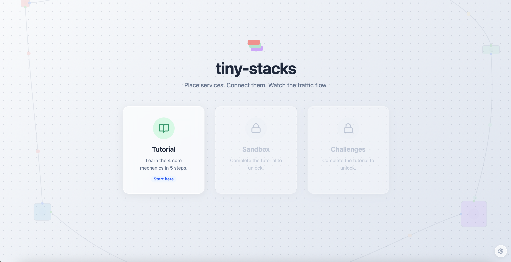
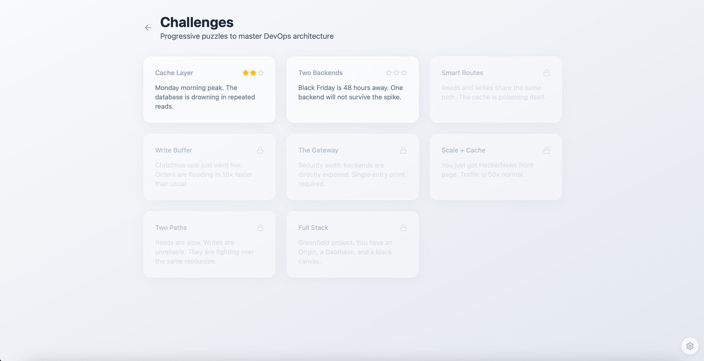

<p align="center">
  
</p>

<h1 align="center">tiny-stacks</h1>

<p align="center">
  A 2D microservices simulation game where you place services, connect them, and watch request packets flow through your system.
</p>

<p align="center">
  <a href="https://tiny-stacks.dawichi.dev">Play it live</a> · <a href="#screenshots">Screenshots</a> · <a href="#how-to-play">How to play</a>
</p>

---

## What is this?

tiny-stacks is a browser game that turns backend architecture into a visual, interactive puzzle. You drag-and-drop services onto a grid (REST APIs, databases, caches, load balancers, message queues), connect their ports, and watch HTTP requests flow through the system as animated packets.

It's designed to make microservice patterns intuitive: you can *see* why a cache reduces database load, *watch* a message queue absorb write bursts, and *feel* the difference a load balancer makes when traffic spikes.

No backend required. Runs entirely in the browser.

## Screenshots

<p align="center">
  
</p>

<p align="center">
  
</p>

## How to play

**Core loop:** Place > Connect > Watch > Optimize

You have 4 actions:
- **Place** a service from the palette onto the grid
- **Connect** two ports by dragging from an output to an input
- **Disconnect** a connection by selecting it and pressing Delete
- **Set route rules** on a connection to filter traffic by HTTP method (GET, POST, PUT, DELETE)

### Game modes

| Mode | Description |
|------|-------------|
| **Tutorial** | Interactive walkthrough that teaches all 4 mechanics step by step |
| **Sandbox** | Unlimited creative building, no goals, just experimentation |
| **Challenges** | 8 progressive puzzles with 3-star ratings and win conditions |

### Services

| Service | What it does |
|---------|-------------|
| **Origin** | Traffic source that spawns HTTP requests at a configurable rate |
| **API Gateway** | Entry point with low-latency routing |
| **REST Service** | Business logic, the main bottleneck at high load |
| **Database** | Persistent storage, slow with limited concurrency |
| **Cache** | Fast reads with HIT/MISS mechanics and automatic invalidation |
| **Message Queue** | Async buffer that absorbs write bursts and decouples producers from consumers |
| **Load Balancer** | Distributes traffic across downstream services |

## Tech stack

- **Angular 21** with Signals, standalone components, and new control flow
- **TailwindCSS v4** for utility-first styling
- **Pure SVG** for connections, packets, and animations (no canvas or WebGL)
- **No backend**, state lives in localStorage

## Running locally

```bash
# Install dependencies
bun install

# Start dev server at localhost:4200
bun start

# Run tests
bun run test

# Lint & format check
bun run check
```

## License

[MIT](LICENSE)
